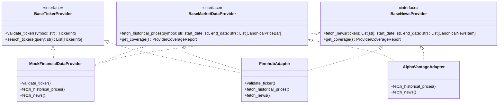

# Step 3.3 — Financial News & Market Data Integrations

**Document:** 06_Financial_Data_Integrations.md  
**Phase:** 3.3 Data Provider Integrations  
**Date:** 2026-11-07  
**Status:** Completed & Verified (57/57 Tests Passing)  

---

## 1. Provider Evaluation & Strategic Comparison

In accordance with Task 1, candidate market data and financial news providers were evaluated across free-tier limits, historical depth, metadata, terms, and integration complexity:

| Provider | Free Tier Availability | Rate Limits | Historical News Depth | Price / Bar Latency | Licensing & Redistribution Terms | Integration Complexity | Evaluation Finding |
| :--- | :--- | :--- | :--- | :--- | :--- | :--- | :--- |
| **Finnhub.io** | Generous developer tier | 60 calls/min | Up to 1 year on company news endpoint | 15-minute delayed (US equities) | Display permitted with attribution; redistribution prohibited without commercial license | Low (standard REST API with clear JSON) | **Recommended Primary Provider** for both news and candle charts. |
| **Alpha Vantage** | Free tier with key | 5 calls/min, 25 calls/day (heavily throttled) | Up to 90 days via `NEWS_SENTIMENT` | 15-minute delayed daily bars | Non-commercial display; strict query throttling | Moderate (JSON formatting requires string parsing) | **Recommended Secondary / Fallback Provider** for news sentiment validation. |
| **Polygon.io** | Free tier with key | 5 calls/min | Last 30 days news on free tier | 15-minute delayed EOD bars | Developer use only; strict commercial limits | Low (REST API with clean pagination) | Viable alternative for price bars; news window on free tier is limited to 30 days. |
| **Yahoo Finance (Unofficial)** | Unofficial / scraped | Unpredictable IP rate limits | Variable / undocumented | 15-minute delayed | No commercial API SLA; explicitly violates Terms of Service for automated scraping | High (fragile HTML/JSON scraping subject to breakage) | **Not recommended** for production due to legal and reliability risks. |

### Architectural Recommendation
1. **Local Development & Automated Testing:** Use the deterministic `MockFinancialDataProvider` (`src/providers/mock_provider.py`). It produces zero external API cost, requires no secrets, supports offline testing, respects market session calendars, and injects realistic syndicated duplicates to test deduplication algorithms.
2. **Production Deployment:** Use `FinnhubAdapter` as primary news and market price adapter, backed by an in-memory/Redis TTL cache (`FinancialDataCache`). Fall back gracefully to `AlphaVantageAdapter` or prompt the user when upstream limits are encountered.

---

## 2. Provider Abstraction Architecture

The application and future agent layers interact strictly with abstract interfaces defined in `src/providers/base.py`:



All adapters instantiate via `ProviderFactory` based on `os.getenv("FINANCIAL_DATA_MODE")` (`"mock"`, `"finnhub"`, or `"alphavantage"`).

---

## 3. Canonical Data Models (`src/models/financial.py`)

### 1. `CanonicalPriceBar`
- `ticker`: Normalized uppercase symbol (e.g. `"AAPL"`).
- `trading_date`: Date string in `YYYY-MM-DD` format.
- `open`, `high`, `low`, `close`: Validated non-negative floats.
- `adjusted_close`: Optional dividend/split adjusted closing price.
- `volume`: Daily share volume.
- `data_provider`: Source identifier (`"Finnhub"`, `"AlphaVantage"`, `"MockMarketDataProvider"`).
- `retrieved_at_utc`: Audit retrieval timestamp.
- **Model Validation:** Model validator strictly asserts $high \ge \max(open, close)$ and $low \le \min(open, close)$.

### 2. `CanonicalNewsItem`
- `article_id`: Unique identifier.
- `ticker_association`: List of normalized associated symbols.
- `headline`: Article title.
- `publisher`: News outlet name (e.g. `"Reuters"`, `"Bloomberg"`).
- `source_url`: Verifiable publisher web link.
- `published_at_utc`: Original article publication timestamp (ISO 8601 UTC).
- `retrieved_at_utc`: Ingestion timestamp.
- `summary_or_description`: Optional licensed abstract/summary.
- `provider_identification`: Provider name.
- `is_duplicate`: Boolean flag indicating syndicated near-duplicate.
- `canonical_article_id`: Points to earliest published canonical article.
- `evidence_flags`: Corroboration tags (`['corroborated']`, `['syndicated_duplicate']`).

---

## 4. Historical Date Filtering & Point-in-Time Guardrails (`src/providers/date_filter.py`)

### Supported Presets
- `"Today"`: Single market session ($as\_of$ to $as\_of$).
- `"7D"`: Prior 7 calendar days.
- `"30D"`: Prior 30 calendar days.
- `"90D"`: Prior 90 calendar days.
- `"Custom"`: Explicit user date range ($start\_date$ to $end\_date$).

### Look-Ahead Leakage Guardrail
To guarantee historical research integrity, `resolve_date_window` strictly prevents look-ahead bias:
```python
if end_dt > cutoff:
    raise ValueError("Point-in-time guardrail violation: end_date exceeds as-of evaluation date.")
```
Additionally, `is_trading_day` filters out weekend calendar sessions (Saturdays and Sundays).

---

## 5. Reliability, Deduplication & Caching

1. **Bounded Retry with Backoff (`request_with_retry`):**
   - Retries up to 3 times on transient network timeouts and 5xx server errors with exponential backoff ($0.5s \to 1.0s \to 2.0s$).
   - Catches HTTP 429 and parses `Retry-After` headers.
2. **Deduplication Engine (`src/providers/deduplication.py`):**
   - Detects exact source URL matches.
   - Detects press wire syndication groups (e.g. PR Newswire, Business Wire).
   - Computes headline token similarity with financial stopword filtering and plural stemming. If semantic overlap $\ge 65\%$ within 48 hours, marks subsequent items as `is_duplicate = True` and links to the canonical record.
   - If secondary publishers report the same story, attaches `evidence_flags = ['corroborated']` to the canonical article.
3. **Response Caching (`src/providers/cache.py`):**
   - Thread-safe TTL cache keyed by `sha256(provider:category:params)`.
   - Default TTL: 5 minutes for news feeds, 1 hour for historical daily bars.
4. **Secure Credential Loading:**
   - Keys loaded dynamically via `os.getenv("FINNHUB_API_KEY")` and `os.getenv("ALPHA_VANTAGE_API_KEY")`. If missing when an adapter is invoked, raises explicit `AuthenticationError`.

---

## 6. Automated Test Results (57/57 Tests Passing)

The test suite expanded from 28 to **57 automated tests** with 100% pass rate:

| Test Module | Tests | Scope | Status |
| :--- | :---: | :--- | :---: |
| `tests/test_financial_models.py` | 5 | Pydantic price bar and news item validation, normalization, high/low constraints | **PASSED** |
| `tests/test_date_filter.py` | 5 | Presets ("Today", "7D", "30D", "90D"), custom ranges, look-ahead guardrails, trading days | **PASSED** |
| `tests/test_deduplication.py` | 3 | Exact URL, syndication groups, headline similarity, corroboration flags | **PASSED** |
| `tests/test_cache.py` | 3 | Cache set/get, parameter isolation, TTL expiration, clear | **PASSED** |
| `tests/test_mock_provider.py` | 7 | Ticker validation, search, price generation, weekend exclusion, simulated failures | **PASSED** |
| `tests/test_live_adapters.py` | 6 | Mocked Finnhub/AlphaVantage parsing, HTTP 429 rate limit, missing key auth errors, factory | **PASSED** |
| `tests/test_database.py` | 5 | Schema migrations, foreign keys, CHECK constraints, cascade deletion | **PASSED** |
| `tests/test_auth.py` | 6 | Scrypt hashing, password complexity, brute-force rate limiting, password recovery | **PASSED** |
| `tests/test_access_control.py` | 10 | 3-free quota, active submission cap, token issue/redeem/revoke/expire, audit redaction | **PASSED** |
| `tests/test_concurrency.py` | 1 | Multi-threaded race condition on final free credit | **PASSED** |
| `tests/test_basic.py` | 6 | Core dependencies, folder structure, config templates, Streamlit `AppTest` | **PASSED** |
| **Total** | **57** | **Zero Regressions Across All Project Subsystems** | **ALL PASSED** |

