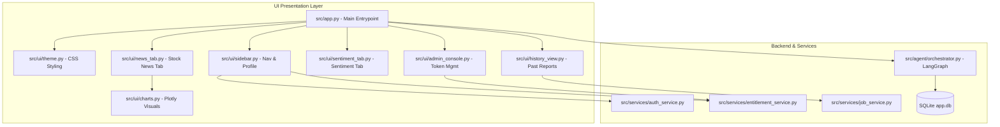

# Streamlit Dashboard & UI Layer (Phase 3.5)

## 1. Visual Design & Presentation Foundation

The **Stock Market News Research Agent** user interface is implemented as a modern financial research dashboard using **Streamlit** (v1.67.0) and **Plotly** (v7.1.0).

In strict adherence to `docs/Phase_2_Architecture_UI_Design/03_UI_Design.md`, the dashboard features:
- **Palette:** Professional deep navy (`#0B192C` / `#1E3E62`), vibrant corporate blue (`#008DDA`), teal highlights (`#00ADB5`), and crisp light card backgrounds (`#FFFFFF` on `#F8FAFC`).
- **Typography & Components:** High-contrast responsive metric cards, badges with semantic colors (`bullish`/green, `bearish`/red, `neutral`/gray, `mixed`/amber), rounded card borders, and clear divider hierarchies.
- **Header:** Branded banner displaying platform name, subtitle, and dynamic UTC system time / as-of timestamps.
- **Sidebar:** Profile card, real-time entitlement badge (Unlimited Access vs 3/2/1/0 Free Requests), navigation menu, access token options, and secure sign-out.
- **Container Sizing:** Full compliance with modern Streamlit standards using `width="stretch"` rather than deprecated `use_container_width`.

---

## 2. Core Dashboard Features

### A. Shared Global Research Controls
1. **Multi-Stock Ticker Selector:**
   - Searchable multiselect supporting up to 5 US stock or ETF tickers.
   - Pre-populated with popular liquid tickers (`AAPL`, `MSFT`, `NVDA`, `GOOGL`, `AMZN`, `META`, `TSLA`, `SPY`, `QQQ`).
   - Selections persist seamlessly across both research tabs.
2. **Historical Date Filters:**
   - Five presets: `Today`, `7D`, `30D`, `90D`, and `Custom`.
   - `Custom` activates dual date input pickers with point-in-time guardrail validation.
3. **Execution & Concurrency Safeguards:**
   - Single "🚀 Launch Research" trigger.
   - Guarded against double-clicks and concurrent execution via `is_researching` state flag.
   - Research results are cached in `st.session_state` by query signature (`f"{tab}_{tickers}_{date_preset}_{start}_{end}_{horizon}"`) to prevent Streamlit widget reruns from re-executing pipelines or consuming free credits.

---

### B. Stock News Tab
- **Company Overview Metrics:** Compact cards displaying latest close price, net price change over research window, exchange, and sector classification.
- **Interactive Price Action (Plotly):**
  - Full OHLC candlestick charts with teal upward candles (`#00ADB5`) and red downward candles (`#EF4444`).
  - Daily trading volume bars matching the price action timeline.
  - Sub-tabs for switching between selected stocks.
- **Multi-Stock Performance Comparison:** Normalized percentage returns chart (`(P_t / P_0 - 1) * 100%`) comparing all selected stocks on a single zero-baseline graph.
- **Financial News Timeline Feed:**
  - Chronological article stream with publisher tags, publication timestamps, and ticker chips.
  - Clickable external source buttons (`Source ↗`).
  - Clear deduplication tags for syndicated wire articles (`⚠️ Syndicated cross-post (deduplicated)`).
- **Agentic AI Research Synthesis:**
  - Executive summary card.
  - Per-stock synthesis of verified corporate developments.
  - Interactive table of grounded source citations.
  - Expandable disclosure of any unverified claims.
- **Data Coverage & Regulatory Notice:** Clear labeling of Mock Provider vs Live Feed status and investment advice disclaimers.

---

### C. Sentiment Research Tab
- **Independent Forward Scenario Horizon:** Selectable horizons of `1`, `7`, `30`, and `90` days forward from the reference date.
- **Multi-Stock Sentiment Comparison Table:** Tabular overview comparing current news sentiment, forward scenario outlook, evidence strength, catalysts count, and risks count across all analyzed tickers.
- **Detailed Scenario Analysis Cards (Per Stock):**
  - Dual status badges: News Sentiment (`BULLISH` / `BEARISH` / `NEUTRAL` / `MIXED`) and Forward Outlook (`BULLISH` / `BEARISH` / `NEUTRAL` / `MIXED`).
  - Evidence strength rating (`STRONG` / `MODERATE` / `WEAK` / `INCONCLUSIVE`).
  - **🚀 Top Catalysts:** Bullet list of verified positive drivers.
  - **⚠️ Downside Risks:** Bullet list of verified headwind factors.
  - **⚖️ Opposing Evidence:** Contradictory arguments and counter-narratives.
- **Grounding Verification Table:** Inspectable citations matching factual claims to canonical article IDs.
- **Forward Scenario Disclaimer:** Explicit notice that outlooks model scenario possibilities, not future price forecasts.

---

### D. Authentication, Entitlements & Admin Console
- **Session Lifecycle:** Secure login, account registration with 3 free credits, password recovery, session token caching, and revocation on sign out.
- **Quota Protection:**
  - Free users see active requests remaining (`3 / 3`, `2 / 3`, `1 / 3`, `0 / 3`).
  - Depleted quota triggers an immediate access modal with **Redeem Token** and **Request Token** actions.
  - Unlimited token holders display a prominent **`🎖️ Unlimited Access`** badge.
- **Administrator Console:**
  - Visible strictly to users with `role='admin'`.
  - Review and approve pending token requests with automatic 30-day expiration.
  - Manually generate high-entropy unlimited access tokens (`sk_res_...`).
  - Revoke active access tokens with immediate enforcement.
  - Inspect audit logs with automatic credential and password redaction.

---

### E. Research History & Saved Reports
- Queries `research_jobs` and `research_reports` via SQLite.
- Displays past research jobs with ticker chips, date ranges, and completion status.
- Includes expandable full-text Markdown reports and one-click download buttons (`.md`).

---

## 3. Automated UI Testing

A dedicated test suite ([`tests/test_ui.py`](file:///c:/Users/Tesse/Desktop/Data Science Portfolio_Nov2026/Stock_Market_News_Research_Agent/tests/test_ui.py)) validates the presentation layer using `streamlit.testing.v1.AppTest` and unit fixtures:

| Test Case | Scope Verified | Status |
| :--- | :--- | :--- |
| `test_candlestick_chart_generation` | Plotly candlestick traces, OHLC mapping, and layout | **PASSED** |
| `test_volume_chart_generation` | Plotly volume bars and color mapping | **PASSED** |
| `test_comparison_chart_generation` | Normalized return calculation and baseline | **PASSED** |
| `test_empty_chart_handling` | Graceful degradation on missing price records | **PASSED** |
| `test_unauthenticated_app_view` | Unauthenticated visit renders login/registration cards | **PASSED** |
| `test_authenticated_dashboard_controls` | Multiselect, date presets, and launch button | **PASSED** |
| `test_quota_exhausted_renders_token_modal` | 0 quota triggers token redemption modal | **PASSED** |
| `test_admin_console_access_isolation` | Admin console restricted to admin roles | **PASSED** |
| `test_news_tab_rendering_with_completed_state` | News synthesis, metrics, citations, and timeline | **PASSED** |
| `test_sentiment_tab_rendering_with_completed_state` | Scenario cards, catalysts, risks, and horizon banner | **PASSED** |
| `test_provider_failure_notice_rendering` | Error banners and quota protection notices | **PASSED** |
| `test_duplicate_submission_prevention_flag` | `is_researching` disables execution button | **PASSED** |

**Test Result:** 12 passed in 5.36s. Overall project regression suite: **77 passed in 15.70s**.

