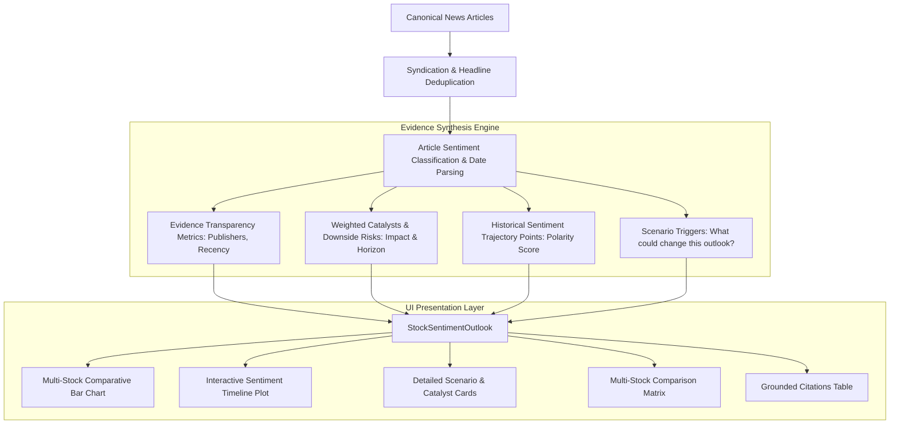

# Sentiment Research Enhancements (Phase 3.6)

## 1. Architectural Overview & Sentiment Methodology

The **Sentiment Research Workbench** enhances the presentation and analytical engine of the **Stock Market News Research Agent**, bridging retrospective financial news evaluation with prospective multi-horizon scenario modeling.

In strict compliance with `docs/Phase_2_Architecture_UI_Design/07_Sentiment_Architecture.md`:
1. **Decoupled Taxonomies:**
   - **Historical News Sentiment:** Evaluates retrospective polarity (`positive`, `negative`, `neutral`, `mixed`) of verified news published up to the reference `as_of_date`.
   - **Forward Scenario Outlook:** Models forward-looking scenario possibilities (`bullish`, `bearish`, `neutral`, `mixed`) over designated horizons (`1`, `7`, `30`, `90` days).
2. **Transparent Weighting (No Fabricated Probabilities):**
   - Strictly prohibits arbitrary numeric percentages (e.g., "78.4% probability").
   - Evidence strength is evaluated qualitatively based on empirical source corroboration:
     - `strong`: $\ge 4$ unique canonical articles across $\ge 2$ distinct publishers.
     - `moderate`: $\ge 2$ unique canonical articles.
     - `weak`: 1 canonical article or low source corroboration.
     - `insufficient`: 0 articles located in the date window.
3. **Anti-Lookahead Bias & Point-in-Time Integrity:**
   - All sentiment timeline markers and evidence aggregation enforce strict point-in-time boundaries relative to `as_of_date`.
4. **Deduplication Corroboration Guard:**
   - Syndicated wire duplicates are flagged and excluded from evidence strength escalation.

---

## 2. Implemented Features

### A. Forward-Looking Horizon Lens
Supports four distinct operational horizons:
- **1 Day (Immediate):** Tactical 24-hour reaction to breaking announcements, management commentary, and immediate price volatility.
- **7 Days (Tactical):** Short-term momentum, post-earnings follow-through, and analyst revision cycles.
- **30 Days (Monthly):** Multi-week operational execution balancing company-specific catalysts against macroeconomic headwinds.
- **90 Days (Strategic):** Quarterly strategic thesis evaluating sustained revenue growth, product roadmaps, and competitive shifts.

### B. Historical Sentiment Trajectory Visualization
- Interactive Plotly timeline (`create_sentiment_timeline_chart`) displaying sentiment scores ($-1.0$ to $+1.0$) across historical article dates.
- Color-coded points (green for positive, red for negative, gray for neutral) with spline curve connections.
- Shaded visual zones demarcating bullish vs bearish sentiment territory.
- Rich hover tooltips showing article publication date, publisher, and headline.

### C. Multi-Stock Sentiment Comparison Matrix & Chart
- Comparative bar chart (`create_multi_stock_sentiment_comparison_chart`) plotting Positive Catalysts (green upward bars), Downside Risks (red downward bars), and Net Sentiment Scores (diamond scatter line).
- Tabular matrix comparing Historical Sentiment, Forward Outlook, Net Sentiment Score, Evidence Strength, Catalyst count, Risk count, and Source Diversity rating across all selected stocks.

### D. Transparently Weighted Catalysts & Risks
- **Weighted Catalysts:** Tagged with qualitative impact (`[HIGH IMPACT]`, `[MEDIUM IMPACT]`), operational horizon (`[IMMEDIATE]`, `[TACTICAL]`, `[STRATEGIC]`), and supporting source article IDs.
- **Downside Risks & Headwinds:** Tagged with headwind severity (`[HIGH HEADWIND]`, `[MEDIUM HEADWIND]`).
- **Opposing Evidence / Counter-Narratives:** Explicitly displays conflicting data points and dissenting analyst perspectives to prevent confirmation bias.

### E. Scenario Sensitivity & Trigger Conditions
- Answers: *"What could alter or invalidate this scenario?"*
- Generates transparent scenario sensitivity conditions (e.g., unexpected regulatory escalation, delivery constraints, or hyperscaler commitment expansions).

### F. Evidence Grounding & Source Diversity Audit Card
- Displays:
  - Total articles evaluated.
  - Canonical unique articles vs syndicated wire copies filtered.
  - Contributing publisher list.
  - Recency distribution (articles within the last 7 days vs older).
  - Source diversity rating (`HIGH`, `MODERATE`, `SINGLE_SOURCE`, `LOW`).

### G. Regulatory Disclaimers
- Prominently states that sentiment scenario analysis models qualitative possibilities rather than deterministic future price targets or buy/sell recommendations.

---

## 3. Automated Test Verification

A dedicated automated test suite ([`tests/test_sentiment_workbench.py`](file:///c:/Users/Tesse/Desktop/Data Science Portfolio_Nov2026/Stock_Market_News_Research_Agent/tests/test_sentiment_workbench.py)) validates all Phase 3.6 capabilities:

| Test Case | Scope Verified | Status |
| :--- | :--- | :--- |
| `test_sentiment_classification_categories` | Bullish, Bearish, Neutral, and Mixed classifications | **PASSED** |
| `test_multi_horizon_handling` | 1, 7, 30, and 90-day horizon parameter routing | **PASSED** |
| `test_distinguish_historical_sentiment_vs_forward_outlook` | Retrospective vs prospective taxonomy separation | **PASSED** |
| `test_evidence_transparency_metrics_calculation` | Publisher count, canonical counts, and diversity rating | **PASSED** |
| `test_syndicated_duplicates_do_not_inflate_evidence_strength` | Duplicate wire articles do not artificially inflate evidence | **PASSED** |
| `test_no_fabricated_probabilities_in_output` | Asserts no arbitrary percentage predictions exist | **PASSED** |
| `test_sentiment_timeline_point_generation` | Timestamped polarity markers bounded by as-of date | **PASSED** |
| `test_missing_evidence_graceful_handling` | Empty coverage defaults to `insufficient` evidence | **PASSED** |
| `test_sentiment_charts_rendering` | Plotly timeline and multi-stock comparison charts | **PASSED** |

**Regression Suite Status:** **86 passed in 16.79s** (100% passing across all 12 test files).

